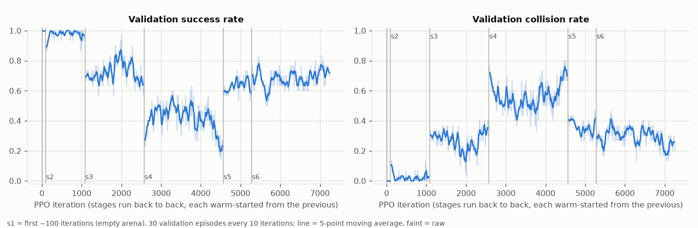
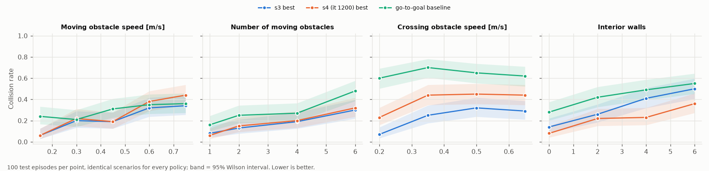
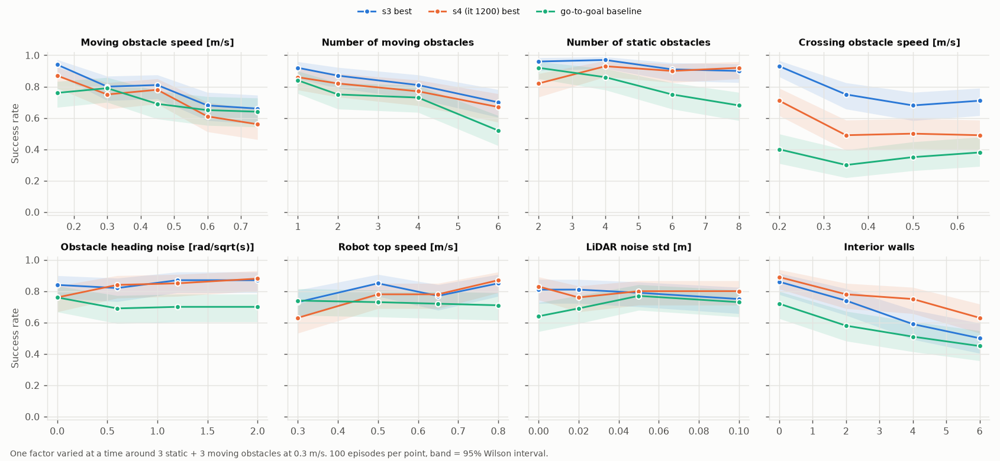
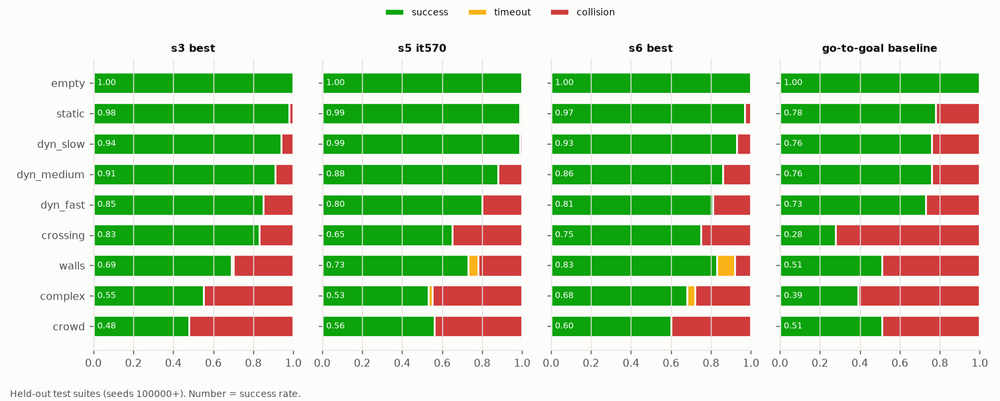

# NavRL: Learning-Based Navigation through Reinforcement Learning

A differential-drive robot with a 60-ray, 360° LiDAR learns with PPO (Stable-Baselines3) to reach random
goals in a 6 m × 6 m arena with static and moving obstacles. There is no map, no planner and no hand-coded
avoidance: the policy maps LiDAR scans, goal direction and its own velocity directly to (v, ω) commands.

Training follows a 3-stage curriculum: **empty arena → static obstacles → moving obstacles**. The full design
rationale, literature grounding and MDP formulation are in [docs/DESIGN.md](docs/DESIGN.md).
**File-by-file code explanation: [docs/EXPLAIN.md](docs/EXPLAIN.md).**

## Quick start: every command in order

```bash
cd NAVRL
source .venv/bin/activate          # created in Setup below

# 0. Sanity checks (~10 s)
python scripts/validate_robot.py                    # expect: 10/10 tests passed
PYTEST_DISABLE_PLUGIN_AUTOLOAD=1 python -m pytest -q -p no:cacheprovider tests/   # expect: 10 passed

# 1. Train the curriculum (each stage warm-starts from the previous one)
TASK=s1_empty   MAX_ITER=100  RUN_NAME=s1 FOREGROUND=1 scripts/train.sh
TASK=s2_static  MAX_ITER=1000 RUN_NAME=s2 FOREGROUND=1 WARM_START=logs/navrl/curriculum/s1/model_100.pt scripts/train.sh
TASK=s3_dynamic MAX_ITER=1500 RUN_NAME=s3 FOREGROUND=1 WARM_START=logs/navrl/curriculum/s2/best_model.pt scripts/train.sh
PHYSICS_DT=0.02 TASK=s5_mix MAX_ITER=1500 RUN_NAME=s5 FOREGROUND=1 WARM_START=logs/navrl/curriculum/s3/best_model.pt scripts/train.sh --num_learning_epochs 5 --num_mini_batches 8
PHYSICS_DT=0.02 TASK=s6_mix MAX_ITER=2000 RUN_NAME=s6 FOREGROUND=1 WARM_START=logs/navrl/curriculum/s5/best_model.pt scripts/train.sh --num_learning_epochs 5 --num_mini_batches 8

# 2. Evaluate the final policy on held-out test scenarios
python scripts/evaluate.py --model logs/navrl/curriculum/s6/best_model.pt --episodes 100

# 3. Watch it live in MuJoCo
python scripts/demo.py --model logs/navrl/curriculum/s6/best_model.pt --stage s4_complex
```

## 1. Setup

Tested on Ubuntu with Python 3.12. No GPU needed; training runs on the CPU.

```bash
git clone https://github.com/sachinmandal3580-rgb/NAVRL.git
cd NAVRL
python3 -m venv .venv
source .venv/bin/activate
pip install --upgrade pip
pip install -r requirements.txt
```

[requirements.txt](requirements.txt) pins the exact versions the project was tested with:

| Package | Version | Used for |
|---|---|---|
| mujoco | 3.10.0 | physics, LiDAR ray casting, viewer |
| gymnasium | 1.4.0 | environment API |
| stable-baselines3 | 2.9.2 | PPO |
| torch | 2.12.0 | policy network |
| numpy, scipy | 1.26.4, 1.17.1 | numerics; shortest-path reward |
| tensorboard, matplotlib | 2.21.0, 3.11.0 | training logs, figures |
| imageio, imageio-ffmpeg | 2.37.3, 0.8.1 | MP4 recording |
| pytest | 9.2.0 | tests |

**Smaller download (CPU-only torch):** the default torch wheel bundles CUDA (~2 GB). Since training uses the
CPU, you can install the CPU build first:

```bash
pip install torch==2.12.0 --index-url https://download.pytorch.org/whl/cpu
pip install -r requirements.txt
```

**Later sessions:** run `source .venv/bin/activate` in the repo before any command below.
`scripts/train.sh` picks up `.venv` by itself, or set `PY=/path/to/python` to use another interpreter.

**Live viewer:** `scripts/demo.py`, `teleop.py` and `goal_nav.py` open a MuJoCo window, so they need a
desktop session. On a headless machine use `demo.py --record out.mp4` instead.

If ROS Jazzy is sourced in your shell, its `PYTHONPATH` breaks pytest plugins. The pytest command above
disables plugin autoload for that reason, and `scripts/train.sh` unsets `PYTHONPATH` itself.

## 2. Sanity checks (run once, before training)

```bash
python scripts/validate_robot.py      # robot physics battery: speed tracking, rotation, curves, braking, wall impact
PYTEST_DISABLE_PLUGIN_AUTOLOAD=1 python -m pytest -q -p no:cacheprovider tests/
python scripts/benchmark.py           # optional: env steps/s and parallel-env scaling (no learning)
```

**Expected:**
- `validate_robot.py` → `10/10 tests passed`
- pytest → `10 passed`. The tests cover:
  - Gymnasium `check_env`;
  - LiDAR accuracy within 1 mm;
  - collision → terminated, timeout → truncated;
  - seeded determinism;
  - go-to-goal ≥ 98% success in an empty arena.

## 3. Training

### How it is organised (rsl_rl style)

- **One iteration** = `NUM_ENVS × NUM_STEPS` env steps (one rollout) followed by one PPO update.
  The default is 4 envs × 1024 steps = **4096 steps per iteration**.
- **4 parallel envs is the benchmarked sweet spot** on this laptop:
  - 6 or 8 envs give only ~6% more throughput;
  - they use more of the 7 GB of RAM;
  - they make each iteration longer.
- **CPU only.** MuJoCo runs on CPU and the policy is a small MLP, so a GPU does not help.
- **Each stage warm-starts** from the previous stage: actor and critic weights are copied, with a fresh
  optimizer and the iteration counter back at 0.
- **`N_STACK` must be the same in every stage.** The default 3 means three stacked LiDAR scans, so the
  policy can see obstacle motion.

### Curriculum commands

```bash
# Stage 1: empty arena, learn goal reaching (~3-4 min)
TASK=s1_empty   MAX_ITER=100  RUN_NAME=s1 FOREGROUND=1 scripts/train.sh

# Stage 2: 3-8 static obstacles (~30-35 min)
TASK=s2_static  MAX_ITER=1000 RUN_NAME=s2 FOREGROUND=1 WARM_START=logs/navrl/curriculum/s1/model_100.pt scripts/train.sh

# Stage 3: 2-5 static + 1-4 moving obstacles, 50% of episodes with a crossing obstacle (~60-70 min)
TASK=s3_dynamic MAX_ITER=1500 RUN_NAME=s3 FOREGROUND=1 WARM_START=logs/navrl/curriculum/s2/best_model.pt scripts/train.sh

# Stage 4: 2-6 interior walls + 2-6 static + 2-6 wandering movers up to 0.6 m/s, 45 s episodes (~2.5-3 h)
TASK=s4_complex MAX_ITER=2000 RUN_NAME=s4 FOREGROUND=1 WARM_START=logs/navrl/curriculum/s3/best_model.pt scripts/train.sh

# Stage 5: mix of all stages + geodesic progress + scans 0.3 s apart (stopped at iteration 717; best at 570)
PHYSICS_DT=0.02 TASK=s5_mix MAX_ITER=1500 RUN_NAME=s5 FOREGROUND=1 WARM_START=logs/navrl/curriculum/s3/best_model.pt scripts/train.sh --num_learning_epochs 5 --num_mini_batches 8

# Stage 6 (final policy): s5 + 120 LiDAR rays + twice the crossing episodes (~2 h)
PHYSICS_DT=0.02 TASK=s6_mix MAX_ITER=2000 RUN_NAME=s6 FOREGROUND=1 WARM_START=logs/navrl/curriculum/s5/best_model.pt scripts/train.sh --num_learning_epochs 5 --num_mini_batches 8
```

Stage 1 converges almost immediately, so its final `model_100.pt` is used for the warm start.

**Stage 5 (`s5_mix`)** is the fix for what stage 4 got wrong. It warm-starts from the s3 model and changes:
- **Stage mix:** every episode is drawn from empty / static / dynamic / dynamic / walls / walls, so earlier
  skills are not forgotten.
- **Geodesic progress:** the progress reward uses the shortest-path distance around walls and static
  obstacles (grid Dijkstra at reset), so detours are no longer punished. Reward only; the policy never sees
  the map.
- **Scans 0.3 s apart** (`stack_gap=3`): the 3 stacked scans span 0.6 s, so movers visibly move between
  them.
- **Reward weights:** time cost 0.005 -> 0.01 (stops hovering near the goal); proximity 0.01 -> 0.03,
  starting at 0.5 m.
- **Speed:** `PHYSICS_DT=0.02` and 5 epochs x 8 minibatches make it about 2x faster per iteration.

**Stage 6 (`s6_mix`, the final policy)** keeps everything from s5 and fixes its two remaining weak spots:
- **120 LiDAR rays** (3° apart instead of 6°). With 60 rays, a 12 cm wall seen end-on fits between two rays
  beyond about 1.1 m, and most s5 wall failures were wall collisions.
- **Twice as many crossing episodes:** a new `s3_crossing` stage, where every episode has a mover aimed at
  the robot's path at 0.2-0.6 m/s, appears twice in the mix. s5 had dropped to 0.65 on crossings.
- **Warm start across ray counts:** the 60-ray s5 network is widened to 120 inputs per scan
  (`checkpoint.widen_rays`). Ray 2i of the new scan points exactly where ray i of the old one did, so it
  copies that column and the in-between rays start at zero. The widened network gives the same actions as
  s5 to within 2e-7, and training then learns to use the extra rays.

**`scripts/train.sh` variables** (set before the command; anything after it passes straight to `train.py`):

| Variable | Default | Meaning |
|---|---|---|
| `TASK` | `s1_empty` | `s1_empty`, `s2_static`, `s3_dynamic`, `s3_crossing`, `s4_complex`, `s5_mix` or `s6_mix` |
| `MAX_ITER` | `100` | PPO iterations |
| `NUM_ENVS` | `4` | parallel envs (CPU processes) |
| `NUM_STEPS` | `1024` | rollout length per env per iteration |
| `N_STACK` | `3` | LiDAR scans in the observation (1 or 3) |
| `PHYSICS_DT` | `0.01` | physics substep; `0.02` is ~1.8x faster with <1 cm trajectory difference |
| `RUN_NAME` | `<task>_<timestamp>` | output folder name |
| `WARM_START` | (empty) | `.pt` checkpoint to initialise weights from |
| `FOREGROUND` | `0` | `1` = run in this terminal; `0` = background with nohup |

Examples of passing extra args: `scripts/train.sh --seed 7`, `scripts/train.sh --learning_rate 1e-4`.

**Running in the background:** drop `FOREGROUND=1`. The script prints the PID, a `tail -f` command
for the log and a `kill` command.

### Console output

One line per iteration, plus a validation eval every 10 iterations:

```
it    37/100 |   2150 sps   1.9s/it | ret   12.39 len    63 | eps  65 succ 1.00 col 0.00 to 0.00 | ETA   2.0 min
  [eval it 40] success=1.00 collision=0.00 timeout=0.00 t_goal=7.3 s  (best success 1.00)
```

What the fields mean:
- `sps`, `s/it`: env steps per second and seconds per iteration.
- `ret`, `len`: mean episode return and episode length in steps (10 steps = 1 s).
- `succ`, `col`, `to`: success, collision and timeout rates of training episodes in this iteration.
- `[eval]`: deterministic policy on 30 fixed validation scenarios.

### What gets saved

Everything goes to `logs/navrl/curriculum/<RUN_NAME>/`:

| File | What |
|---|---|
| `model_<iter>.pt` | checkpoint every 25 iterations, plus one at the end |
| `best_model.pt` | best validation result, ranked by success rate, then fewer collisions, then faster time-to-goal |
| `tb/` | TensorBoard logs |
| `config.json` | all arguments and environment parameters |
| `../<RUN_NAME>.stdout.log` | console output (background runs only) |

- **Checkpoints are plain `torch.save` dicts** containing:
  - `model_state_dict` and `optimizer_state_dict`;
  - `iteration` and `num_timesteps`;
  - `obs_dim`, `act_dim`, `n_stack` and `task`.
- **Ctrl+C is safe:** it saves `model_<iter>.pt` before exiting.

### Resume an interrupted run

`--resume` restores the weights, optimizer and iteration count:

```bash
python scripts/train.py --task s2_static --max_iterations 1000 --n_stack 3 \
    --resume true --load_run logs/navrl/curriculum/s2                       # latest model_<iter>.pt
python scripts/train.py --task s2_static --max_iterations 1000 --n_stack 3 \
    --resume true --load_run logs/navrl/curriculum/s2 --checkpoint model_500.pt
```

### Monitor with TensorBoard

```bash
tensorboard --logdir logs/          # open http://localhost:6006
```

| Curve | What to look for |
|---|---|
| `eval/success`, `eval/collision` | the main progress signal |
| `train/success_rate`, `collision_rate`, `timeout_rate` | outcome rates of training episodes |
| `reward/progress`, `goal`, `collision`, `time`, `smooth`, `proximity` | each reward term separately, to spot which one dominates |
| `behaviour/stationary_frac` | rising = robot freezing |
| `behaviour/mean_abs_w_action` | high with low progress = spinning |
| `train/explained_variance` | should approach 1 (value function fits) |
| `train/std` | exploration noise; should shrink slowly |

**Stop and debug rather than training longer if:**
- stage 1 eval success is below 0.5 after ~75 iterations; or
- stage 2/3 collision rate is not falling after ~150 iterations.

## 4. Evaluation

```bash
python scripts/evaluate.py --model logs/navrl/curriculum/s3/best_model.pt --episodes 50
python scripts/evaluate.py --model logs/navrl/curriculum/s2/best_model.pt --suites empty static --episodes 50
python scripts/evaluate.py --controller gotogoal --episodes 50          # obstacle-blind baseline
```

**Test suites:**

| Suite | Content |
|---|---|
| `empty` | walls only |
| `static` | 6 static obstacles |
| `dyn_slow` / `dyn_medium` / `dyn_fast` | 3 static + 3 moving obstacles at 0.15 / 0.30 / 0.45 m/s |
| `crossing` | 2 static + 2 moving obstacles, one scripted to cross the robot's path at 0.30 m/s |
| `walls` | 4 interior walls + 3 static obstacles (needs detours) |
| `complex` | 4 interior walls + 3 static + 4 wandering movers at 0.40 m/s |
| `crowd` | 2 interior walls + 2 static + 6 wandering movers at 0.50 m/s |

**Metrics per suite:**
- success, collision and timeout rates;
- time-to-goal, path length, and path length ÷ straight-line distance (all three on **successful episodes only**);
- mean minimum clearance to obstacles.

**Fairness:** test scenarios use seeds 100000+, which never appear in training (seeds < 10000) or in
validation (50000+). Every policy sees exactly the same scenarios.

**Output:** `results/<name>/summary.json`, `episodes.json` and `traj_<suite>.png` (top-down trajectory plots).

**Baseline to beat:** the obstacle-blind go-to-goal controller drives straight at the goal. 50 episodes per suite:

| Suite | Success | Collision | Timeout |
|---|---|---|---|
| empty | 1.00 | 0.00 | 0.00 |
| static | 0.76 | 0.24 | 0.00 |
| dyn_slow / medium / fast | 0.84 / 0.86 / 0.82 | 0.16 / 0.14 / 0.18 | 0.00 |
| crossing | 0.34 | 0.66 | 0.00 |

A policy that has really learned avoidance should clearly beat these numbers on `static` and especially on `crossing`.

### Robustness sweeps (`scripts/robust_eval.py`)

`evaluate.py` tests a few fixed suites. `robust_eval.py` varies **one factor at a time** around a base
scenario (3 static + 3 movers at 0.3 m/s) and compares policies on identical scenarios, with 95% confidence
intervals:

```bash
python scripts/robust_eval.py --models logs/navrl/curriculum/s3/best_model.pt \
                                       logs/navrl/curriculum/s4/best_model.pt --baseline
python scripts/robust_eval.py --models logs/navrl/curriculum/s4/best_model.pt --episodes 30 --sweeps obs_speed robot_vmax
```

| Sweep | Values | What it tests |
|---|---|---|
| `obs_speed` | 0.15 … 0.75 m/s | faster movers, beyond the training range |
| `n_dynamic` | 1 … 6 movers | crowding |
| `n_static` | 2 … 8, no movers | clutter |
| `crossing_speed` | 0.2 … 0.65 m/s | a mover aimed at the robot's path |
| `wander` | 0 … 2 rad/√s | unpredictable (pedestrian-like) movers |
| `robot_vmax` | 0.3 … 0.8 m/s | robot faster/slower than trained (0.5) |
| `lidar_noise` | 0 … 0.10 m std | sensor noise |
| `walls` | 0 … 6 interior walls | maze-like layouts |

- **Episodes:** 100 per point by default. Runs in parallel (`--workers`, default 4).
- **Output:** `results/robust/<name>/` contains `summary.csv`, `summary.json`, `success.png` and
  `collision.png`.
- **Reading the results:** overlapping CI bands mean the difference is not significant.

## 5. Watch it live in MuJoCo

```bash
# Final policy among moving obstacles
python scripts/demo.py --model logs/navrl/curriculum/s3/best_model.pt --stage s3_dynamic

# Earlier stages (works while training is still running, with any saved checkpoint)
python scripts/demo.py --model logs/navrl/curriculum/s1/model_100.pt  --stage s1_empty
python scripts/demo.py --model logs/navrl/curriculum/s2/best_model.pt --stage s2_static

# Obstacle-blind baseline for contrast
python scripts/demo.py --controller gotogoal --stage s3_dynamic

# Save an MP4 instead of opening the viewer
python scripts/demo.py --model logs/navrl/curriculum/s3/best_model.pt --stage s3_dynamic --episodes 5 --record demo.mp4
```

**Viewer keys:** `SPACE` pause/resume, `N` next episode, `R` toggle LiDAR rays. Use the mouse to rotate and zoom.

**On screen:**
- blue robot with a white heading marker;
- small green goal marker (the success zone is still 0.3 m around it);
- grey static obstacles and orange moving obstacles;
- LiDAR rays, green when far and red when close;
- blue trail of the path driven.

The terminal prints each episode's outcome (`success` / `collision` / `timeout`).

**Options:**

| Option | Meaning |
|---|---|
| `--episodes N` | number of episodes (default 10) |
| `--speed 2` | playback speed multiplier |
| `--seed S` | first scenario seed (default 200000, outside training and test seeds) |
| `--stage` | which arena to show: `s1_empty`, `s2_static`, `s3_dynamic` or `s4_complex` |

The demo can run while training is in progress, but it shares the CPU, so training slows down a little.

### Drive it yourself (keyboard teleop)

```bash
python scripts/teleop.py                      # moving + static obstacles
python scripts/teleop.py --stage s2_static    # static only
python scripts/teleop.py --stage s1_empty
```

Click the viewer window first so it has keyboard focus.

| Key | Action |
|---|---|
| `UP` / `DOWN` | forward speed ±0.1 m/s (−0.2 … 0.5) |
| `LEFT` / `RIGHT` | turn left / right, yaw rate ±0.3 rad/s (±1.5) |
| `SPACE` | stop |
| `ENTER` | new episode |
| `R` | toggle LiDAR rays |

- **Same pipeline as the policy:** your commands go through the same `env.step()`, so the same
  acceleration limits, collision/goal detection and reward apply.
- **Live status in the terminal:** commanded vs. measured speed, goal distance, clearance and running return.
- **Episode end:** on a collision, success or timeout (60 s for manual driving), the outcome is printed
  and the next episode starts automatically.

### Give goals by hand (trained policy drives there)

```bash
python scripts/goal_nav.py --model logs/navrl/curriculum/s3/best_model.pt
python scripts/goal_nav.py --model logs/navrl/curriculum/s4/best_model.pt --stage s4_complex
python scripts/goal_nav.py --controller gotogoal --stage s2_static      # baseline for contrast
```

| How | What to do |
|---|---|
| Terminal | type `x y` + Enter (metres, arena is −3…3), e.g. `1.5 -2`; `r` = random goal, `q` = quit |
| Keys (click viewer first) | arrows move the goal 0.25 m; `SPACE` pause; `ENTER` new obstacle layout; `R` rays |
| Mouse | double-click the small green goal marker, then `Ctrl` + right-drag to move it |

- The robot drives to the goal and **waits there** until you give a new one. There is no time limit.
- **On a collision** the obstacle layout is re-generated and the robot restarts; your goal is kept.
- **Goals are clamped** 0.35 m inside the walls. You get a warning if the goal sits inside a static
  obstacle or wall, because the robot can never reach it.

## Figures

Regenerate all of them with `python scripts/plot_results.py` (it reads `logs/` and `results/`).

**Training curves.** Validation success and collision rate across the curriculum, stages run back to back.
Stage 4 peaks around iteration 1200 of the stage and then gets worse, so more iterations alone don't help.



**Collision rate vs difficulty.** One factor varied at a time, 100 test episodes per point, 95% intervals.



**Success rate on every robustness sweep.**



**Outcome per test suite.**



## How it works

### Robot and simulation

The robot is a 3.4 kg cylindrical chassis (r = 0.15 m) on planar joints (x, y, yaw), driven by
force-limited velocity servos.

- **Differential-drive constraint:** the commanded velocity always points along the heading (no sideways
  motion). This is re-applied every 0.01 s physics substep.
- **Command pipeline:** policy action → (v, ω) → acceleration limit (1 m/s², 3 rad/s²) → wheel inverse
  kinematics with wheel-speed limits (r = 0.04 m, track 0.28 m) → base servos.
- **Timing:** 10 Hz control; 0.01 s physics step (0.02 s for stages 5 and 6).

### LiDAR

360° scan, range 3 m, cast with `mujoco.mj_multiRay`: 60 rays (6° apart) in stages 1-5 and 120 rays
(3° apart) in the final stage 6. The rays see only walls and obstacles, never the robot itself or the floor.

### Obstacles

- **All obstacles are mocap bodies**, placed at reset with a minimum clearance from the start and goal.
- **Moving obstacles** travel at constant velocity (0.1-0.45 m/s) and bounce off walls, static obstacles
  and each other. Their positions are updated every physics substep.
- **Crossing obstacles** are aimed at the robot's straight-line path to the goal.
- **Interior walls (stage 4)** are 8 pooled box segments (1.0-2.5 m long, 0.12 m thick), mostly
  axis-aligned, so random layouts form corridors, L- and T-shapes. A grid flood-fill (robot radius
  inflated) checks that the goal is still reachable; blocked layouts are resampled.
- **Wandering movers (stage 4)** random-walk their heading (pedestrian-like), so they cannot be
  predicted by straight-line extrapolation. They also bounce off the interior walls.
- **Looks:** the robot has a bumper, top deck, LiDAR puck, hubs and LEDs; movers are orange
  cylinders; static obstacles are crates and pillars. All decoration is visual-only (no mass, no contacts,
  invisible to the LiDAR), so it does not change the physics or what the policy sees.

### Observation

`n_rays × 3 + 7` values: 187 with 60 rays, 367 with 120 rays (final policy).

| Part | Size | Content |
|---|---|---|
| LiDAR scans | n_rays × 3 | newest first, normalised to [0, 1]; 0.1 s apart (stages 1-4) or 0.3 s apart (`stack_gap=3`, stages 5-6) |
| Goal | 3 | distance; sin and cos of the goal bearing |
| Velocity | 2 | measured v and ω |
| Previous action | 2 | last command |

### Action

2 values in [−1, 1], mapped to v ∈ [−0.2, 0.5] m/s and ω ∈ [−1.5, 1.5] rad/s. An action of 0 means "stop".

### Reward

Every term is logged separately.

| Term | Stages 1-4 | Final (stages 5-6) |
|---|---|---|
| Progress | `+1.0 × (d_prev − d)`, d = straight-line distance | same, but d = **shortest-path distance** around walls and static obstacles |
| Goal | `+10` on success | `+10` |
| Collision | `−10` | `−10` |
| Time | `−0.005` per step | `−0.01` per step |
| Smoothness | `−0.001 × ‖Δa‖²` | same |
| Proximity | `−0.01 × max(0, 1 − clearance/0.4)` | `−0.03 × max(0, 1 − clearance/0.5)` |

**Shortest-path distance:** at reset, a 5 cm grid of positions the robot centre can occupy is built (walls and
static obstacles inflated by the robot radius), and Dijkstra from the goal gives a distance field. The
reward looks the field up (bilinear) at the robot position. The policy never sees the field; it is reward
only, like a teacher who knows the map.

### Episode end

| Event | Result |
|---|---|
| Any chassis contact | **terminated** (collision) |
| Goal distance < 0.3 m | **terminated** (success) |
| 300 steps (30 s); 450 (45 s) in stages 4-6 | **truncated** (timeout; PPO bootstraps the value) |

### PPO settings

| Setting | Value |
|---|---|
| Network | MLP [256, 256], tanh, separate actor/critic |
| Learning rate | 3e-4 |
| γ / λ | 0.99 / 0.95 |
| Clip | 0.2 |
| Epochs | 10 (5 in stages 5-6) |
| Mini-batches | 16 (8 in stages 5-6) |
| Initial log-std | −0.5 |

## What is simplified (honest list)

- **Planar base instead of wheel-ground contact.** A full wheel-contact model was built and validated
  first. It tracked well at low speed but slipped heavily at 0.5 m/s (wheels at 0.49 m/s, body at
  0.15-0.22 m/s). The wheels are therefore visual only and wheel slip is not simulated. Kinematics,
  speed/acceleration limits, inertia and collisions are still simulated.
- Moving obstacles are kinematic and do not react to the robot.
- LiDAR is noise-free during training (robustness to noise is only tested); there is no domain randomisation.
- The shortest-path reward uses map knowledge the robot does not have. It shapes learning only; the
  policy acts on LiDAR alone.
- Single training seed; the single-scan vs. stacked-scan comparison from the design is not done yet.

## Results so far

**Stage 1 (empty arena, 100 iterations):**
- Validation success reached 1.00 by iteration 10, with 0 collisions.
- Time-to-goal fell from 15.2 s to 7.3 s, on par with the straight-line go-to-goal controller (7.4 s).
- Training speed was ~2,150 env steps/s, about 1.9 s per iteration.

**Stage 3 (moving obstacles, 1500 iterations), 50 test episodes per suite:**

| Suite | `best_model.pt` (it 930) success / collision | `model_1500.pt` success / collision | go-to-goal success |
|---|---|---|---|
| empty | 1.00 / 0.00 | 0.98 / 0.00 | 1.00 |
| static | 0.98 / 0.02 | 0.92 / 0.06 | 0.76 |
| dyn_slow | 0.94 / 0.06 | 0.92 / 0.08 | 0.84 |
| dyn_medium | 0.92 / 0.08 | 0.88 / 0.12 | 0.86 |
| dyn_fast | 0.88 / 0.12 | 0.94 / 0.06 | 0.82 |
| crossing | **0.92 / 0.08** | 0.68 / 0.32 | 0.34 |

- The best model beats the baseline in every obstacle suite, most clearly on `crossing` (0.92 vs 0.34).
- It is cautious: time-to-goal is ~9.3 s (path ratio 1.45) vs ~7.5 s for `model_1500.pt`. The final model
  is faster but collides far more on crossings, so validation picked the safer one.
- Single training seed, so differences of a few percent between suites are within noise.

**Before stage 4 training**, 20 test episodes per new suite (success / collision):

| Suite | s3 `best_model.pt` | go-to-goal |
|---|---|---|
| walls | 0.70 / 0.30 | 0.45 / 0.55 |
| complex | 0.55 / 0.45 | 0.30 / 0.70 |
| crowd | 0.45 / 0.55 | 0.55 / 0.45 |

The new arena is clearly harder: the s3 policy has never seen walls inside the arena or 0.5 m/s wandering movers.
**Robustness sweeps** (`results/robust/s3_s4_baseline/`), 100 episodes per point with 95% CIs, comparing
s3 best, s4 best at iteration 1200 (training still running) and go-to-goal:

- **Static clutter: clearly learned.** With 8 static obstacles, s3 and s4 reach 0.90-0.92 success vs 0.68 for
  the baseline; s4 has 1-4% collisions.
- **Crossing obstacles: clearly learned by s3** (0.68-0.93 vs 0.30-0.40). s4 is worse at crossings
  (0.49-0.71): it partly forgot this while learning walls.
- **Walls: s4 is better** (0.75 vs 0.59 with 4 walls, 0.63 vs 0.50 with 6).
- **Generic moving obstacles: weak.** At 3 movers × 0.3 m/s, s3 scores 0.80 [0.71-0.87] vs 0.79 for the
  baseline, so no significant gain. Above 0.6 m/s (faster than the robot) all policies drop to ~0.6.
- **Robust to sensor noise** (up to 0.10 m std) and robot top speed 0.5-0.8 m/s. Success drops at
  0.3 m/s, because a slow robot cannot escape movers.

**Stage 4 (2000 iterations), 100 test episodes per suite, success rate:**

| Suite | s3 best | s4 best (it 1200) | s4 final (it 2000) | go-to-goal |
|---|---|---|---|---|
| empty | **1.00** | 0.83 | 0.93 | 1.00 |
| static | **0.98** | 0.90 | 0.84 | 0.78 |
| dyn_slow | **0.94** | 0.87 | 0.82 | 0.76 |
| dyn_medium | **0.91** | 0.85 | 0.78 | 0.76 |
| dyn_fast | **0.85** | 0.76 | 0.66 | 0.73 |
| crossing | **0.83** | 0.56 | 0.64 | 0.28 |
| walls | 0.69 | **0.83** | 0.69 | 0.51 |
| complex | 0.55 | **0.62** | 0.48 | 0.39 |
| crowd | 0.48 | **0.53** | 0.42 | 0.51 |

What went wrong in stage 4 (from classifying every failed episode):
- **It stalls near the goal.** s4 best times out in 17% of episodes in an empty arena, stopping, circling or
  wandering 0.4-1 m from the goal. Hovering only cost 0.005 per step, far less than the risk of a
  collision.
- **It forgot crossings:** 0.83 for s3, 0.56 for s4.
- **Wall collisions:** with the straight-line progress reward, going around a wall is punished, so it cuts
  corners.
- **Most remaining collisions are with movers**, which the 0.1 s scan stack barely shows as motion.

Stage `s5_mix` addresses each of these (see Training).

**Stage 5 (best checkpoint, iteration 570), 100 test episodes per suite, success rate:**

| Suite | s5 (it 570) | s3 best | s4 best |
|---|---|---|---|
| empty | **1.00** | 1.00 | 0.83 |
| static | **0.99** | 0.98 | 0.90 |
| dyn_slow | **0.99** | 0.94 | 0.87 |
| dyn_medium | 0.88 | **0.91** | 0.85 |
| dyn_fast | 0.80 | **0.85** | 0.76 |
| crossing | 0.65 | **0.83** | 0.56 |
| walls | 0.73 | 0.69 | **0.83** |
| complex | 0.53 | 0.55 | **0.62** |
| crowd | **0.56** | 0.48 | 0.53 |

- **Fixed:** no more stalling (0 timeouts in the empty arena), and paths are 1.22x the straight line vs
  1.48x for s3/s4.
- **Still weak:** every dynamic-suite collision was with a mover; crossings dropped to 0.65; about 20 of
  every 100 wall-suite episodes ended in a wall collision. Stage 6 targets both.

**Stage 6 (final policy):** to be filled in after training.

## Project layout

### File tree

Generated outputs (`logs/`, `results/`) are created by training and evaluation and are gitignored.

```
NAVRL/
├── assets/
│   └── arena.xml                 # MJCF: robot, 6x6 m arena, walls, goal, obstacle pools, servos, sensors
├── docs/
│   ├── DESIGN.md                 # full design: literature, MDP, reward, curriculum, evaluation plan
│   └── EXPLAIN.md                # file-by-file code explanation
├── navrl/                       # the Python package
│   ├── __init__.py               # asset paths
│   ├── callbacks.py              # per-iteration logging, validation eval, checkpoints, episode metrics
│   ├── checkpoint.py             # .pt save/load (torch.save dict)
│   ├── config.py                 # EnvConfig, RewardConfig, stage presets s1/s2/s3
│   ├── controllers.py            # GoToGoal obstacle-blind baseline
│   ├── env.py                    # NavRLEnv (Gymnasium): obs, reward terms, termination/truncation
│   ├── lidar.py                  # 60-ray 360° LiDAR via mj_multiRay
│   ├── obstacles.py              # obstacle placement, motion, crossing scenarios
│   ├── robot.py                  # action mapping, accel limits, diff-drive kinematics, base servos
│   └── viz.py                    # viewer overlays (rays, trail), trajectory plots
├── scripts/
│   ├── benchmark.py              # env throughput / parallel-env scaling
│   ├── demo.py                   # live MuJoCo viewer or MP4 recording
│   ├── evaluate.py               # held-out test suites -> results/<name>/
│   ├── train.py                  # training CLI (--task --num_envs --max_iterations --warm_start --resume)
│   ├── plot_results.py           # README figures (training, difficulty, suites)
│   ├── robust_eval.py            # one-factor sweeps with 95% CIs
│   ├── goal_nav.py               # set goals by hand (terminal / keys / mouse), policy drives
│   ├── teleop.py                 # drive the robot yourself with the keyboard (live viewer)
│   ├── train.sh                  # training wrapper (TASK= MAX_ITER= NUM_ENVS= WARM_START= FOREGROUND=)
│   └── validate_robot.py         # robot physics validation battery
├── tests/
│   └── test_env.py               # unit tests (check_env, LiDAR, collisions, truncation, determinism)
├── logs/                         # (generated) training runs
│   └── navrl/
│       └── curriculum/
│           ├── s1/               # stage 1: empty arena
│           │   ├── best_model.pt
│           │   ├── model_25.pt  model_50.pt  model_75.pt  model_100.pt
│           │   ├── config.json
│           │   └── tb/           # TensorBoard events
│           ├── s2/               # stage 2: static obstacles (same structure, up to model_1000.pt)
│           ├── s3/               # stage 3: moving obstacles (up to model_1500.pt)
│           └── s4/               # stage 4: walls + crowds (up to model_2000.pt)
├── figures/                      # README figures (committed)
├── results/                      # (generated) evaluation outputs
│   └── <name>/                   # e.g. gotogoal/, s3_best_model/
│       ├── summary.json          # per-suite metrics
│       ├── episodes.json         # per-episode outcomes + trajectories
│       └── traj_<suite>.png      # top-down trajectory plots (empty, static, dyn_*, crossing)
├── .gitignore
├── requirements.txt              # pinned Python dependencies (pip install -r)
└── README.md
```

### Module summary

```
assets/arena.xml          robot + arena + obstacle pools (MJCF)
navrl/robot.py           action -> (v, w) -> accel limit -> wheel IK -> base servos
navrl/lidar.py           60-ray mj_multiRay LiDAR
navrl/obstacles.py       obstacle placement, motion, crossing scenarios
navrl/config.py          all parameters + curriculum stage presets
navrl/env.py             Gymnasium env (observation, reward terms, termination/truncation)
navrl/controllers.py     GoToGoal baseline
navrl/callbacks.py       per-iteration logging, validation eval, checkpoints, episode metrics
navrl/checkpoint.py      .pt checkpoint save/load
navrl/viz.py             viewer overlays (rays, trail), trajectory plots
scripts/train.sh          training wrapper (env-var driven, like bobruple's train_*.sh)
scripts/train.py          training CLI (--task --num_envs --max_iterations --warm_start --resume ...)
scripts/evaluate.py       held-out evaluation + trajectory plots
scripts/demo.py           live MuJoCo viewer / MP4 recording
scripts/teleop.py         keyboard teleop in the live viewer
scripts/validate_robot.py robot physics validation battery
scripts/benchmark.py      env throughput benchmark
tests/test_env.py         unit tests
docs/DESIGN.md            full design document
```

## Troubleshooting

| Problem | Fix |
|---|---|
| `ModuleNotFoundError: lark` / pytest plugin errors | ROS on `PYTHONPATH`: use `PYTEST_DISABLE_PLUGIN_AUTOLOAD=1` (see above) |
| Viewer window doesn't open | Needs a desktop session (`DISPLAY` set). Headless: use `--record demo.mp4` |
| Laptop slows down or swaps | Lower `NUM_ENVS` (4 max recommended) and close the demo viewer while training |
| `size mismatch` when warm-starting | `N_STACK` differs between stages; it must be the same everywhere |
| Training is slow | Check `sps` in the console: ~2,000+ is normal; other heavy processes compete for CPU |
